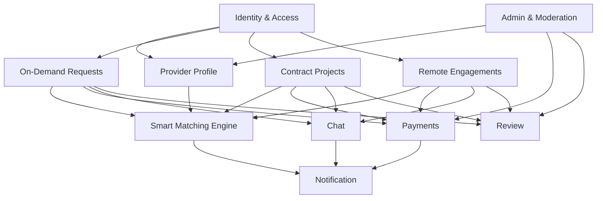

# SAHL — Architecture & Tech Stack

Status: Draft v1.0 · Depends on: [01-product-overview.md](01-product-overview.md)

## 1. Repository Layout (monorepo)

```
sahl/
├── apps/
│   ├── backend/          # Next.js + TypeScript API, admin web console
│   └── mobile/           # Flutter app (customer + provider, single app, role-switchable)
├── packages/
│   └── shared/           # cross-cutting: type contracts, i18n resource schema, constants, validation schemas
├── infra/                # IaC, deploy configs, docker, CI
└── docs/                 # this documentation set
```

`packages/shared` exists specifically so the API contract (DTOs, enums, Zod schemas) is defined once and consumed by backend + generated into Dart for mobile — prevents drift between the two clients instead of hand-syncing types.

## 2. Backend: Clean Architecture Layers

```
apps/backend/src/
├── domain/            # entities, value objects, domain events, repository INTERFACES — zero framework deps
│   ├── identity/
│   ├── provider/
│   ├── on-demand/
│   ├── contract/
│   ├── remote/
│   ├── payments/
│   ├── matching/
│   ├── chat/
│   └── review/
├── application/        # use cases (application services), orchestrate domain + repository interfaces
│   └── <same modules>/
├── infrastructure/      # Prisma repositories, Redis cache, Cloudinary adapter, payment gateway adapters, FCM, Socket.IO emitters
│   └── <same modules>/
└── presentation/        # Next.js route handlers (app/api/**), request validation, auth middleware, DTO mapping
    └── <same modules>/
```

Rule: dependencies point inward only (`presentation → application → domain`, `infrastructure → domain` interfaces). `domain/` never imports Prisma, Next.js, or any SDK. This is what keeps the matching engine, contract state machine, etc. unit-testable without a database.

Each bounded-context module (identity, provider, on-demand, contract, remote, payments, matching, chat, review, notification, admin) owns its four layers and communicates with other modules only through application-layer interfaces or domain events — not by reaching into another module's Prisma models directly. This is the modularity/no-duplicated-logic requirement from the brief made concrete.

## 3. Bounded Contexts



Identity is upstream of everything (every action is authorized against it). Matching is a consumer of Provider + the three request-type contexts, never the other way around — this keeps the ranking algorithm swappable ([06-smart-matching.md](06-smart-matching.md)) without touching request lifecycle code.

## 4. Tech Stack & Rationale

| Layer | Choice | Why |
|---|---|---|
| Mobile | Flutter | Single codebase for customer + provider experiences across iOS/Android, matches Material 3 requirement natively |
| Backend API | Next.js (App Router) + TypeScript | Route handlers double as the admin web console's backend; TS gives shared typing with `packages/shared` |
| ORM | Prisma | Type-safe schema-first modeling, migration tooling suited to a fast-growing schema |
| Database | PostgreSQL | Relational integrity for contracts/payments/bids; PostGIS extension available for geo-distance queries in matching |
| Cache | Redis | Session/rate-limit counters, matching-engine hot data (provider availability, geo index), Socket.IO horizontal scaling adapter |
| Realtime | Socket.IO | Live order tracking, chat, provider availability pushes |
| Storage | Cloudinary, behind a `StorageProvider` interface | Provider docs, chat attachments, contract files, image transforms for listings; abstracted per [00-system-architecture.md](00-system-architecture.md) so S3/Azure/GCS are additive infrastructure modules later, same pattern as `PaymentProvider` (ADR-001) |
| Auth | JWT (access) + refresh tokens + OTP | Stateless API auth, OTP for phone/email verification and step-up auth on sensitive actions |
| Push | Firebase Cloud Messaging | Cross-platform push to Flutter app |
| Maps | Google Maps | Geocoding, live tracking, distance calc for on-demand matching |
| Payments | Abstract `PaymentProvider` interface | See ADR-001 |
| Background jobs | BullMQ (Redis-backed) + cron scheduler | Email/SMS/push sending, image processing, analytics aggregation, scheduled reports, referral reward grants, subscription renewals, cleanup — anything that shouldn't block a request/response cycle |

## 5. ADR-001: Locale & Payment Abstraction

**Decision**: Country, currency, language, and payment gateway are never hardcoded into business logic.

- **Country/Region**: a `Region` config table (code, name, default currency, default language, enabled payment providers) drives which options are shown; the app ships with exactly one seeded `Region` row at launch (`SD` / Sudan, currency `SDG`) but the code path is identical for N regions.
- **Currency**: all monetary values stored as integer minor units (e.g. fils/cents) + ISO 4217 currency code column, never floats. Display formatting is locale-aware at the presentation layer only.
- **Language**: UI strings live in `packages/shared/i18n/{en,ar}.json` resource files (never inline strings in components/widgets). User-generated content that needs translation (category names, system notifications) stores a translation-key or a `Translations` join table, not free text duplicated per-language columns.
- **Payments**: `domain/payments` defines a `PaymentProvider` interface (`initiate`, `capture`, `refund`, `verifyWebhook`). `infrastructure/payments/<gateway>` implements it per gateway. Which implementation is active is resolved per-`Region` at runtime via a registry, so adding a country's gateway is an additive infrastructure module, not a business-logic change.

This directly satisfies the brief's "support multiple countries/currencies/languages/payment gateways without redesign" requirement — it's an architectural constraint, not a phase-2 feature.

## 6. ADR-002: Realtime Service Is Decoupled From the API

**Problem**: Next.js API routes are best deployed in a stateless/serverless-friendly way, but Socket.IO needs a long-lived process, and "millions of users" means the realtime layer must scale independently of request volume on the REST API.

**Decision**: Socket.IO runs as its own Node process/service (`apps/backend` exposes it via a dedicated entry point, deployed and scaled separately from the API route handlers), using the Redis adapter for cross-instance pub/sub. The API and the realtime service both read/write through the same domain/application layer contracts (not duplicated logic) but are independently deployable and scalable. Clients (mobile + admin web) connect to the realtime service directly for chat/tracking/notifications and to the API for everything else.

## 7. ADR-003: Scheduled Service Is a Booking Mode of On-Demand, Not a Fourth Bounded Context

**Problem**: [00-business-requirements.md](00-business-requirements.md) lists "Scheduled Service" (booked for a future date, appointment management, calendar integration, reminders) as a peer of On-Demand, Contract, and Remote. Taken literally, that suggests a fourth bounded context alongside `on-demand`, `contract`, `remote`.

**Decision**: Scheduled is modeled as a **fulfillment mode on the existing On-Demand context**, not a new bounded context — `OnDemandRequest` gains a `fulfillmentMode` (`INSTANT | SCHEDULED`) and a nullable `scheduledFor` timestamp, rather than a parallel `ScheduledRequest` aggregate.

**Why**: A scheduled plumbing visit and an instant plumbing visit share the same category taxonomy, the same provider pool, the same matching factors (distance/rating/etc. still apply, just evaluated against a future time window instead of "right now"), the same assignment/chat/payment/review lifecycle — the only real difference is *when* the work happens and that the matching engine reserves a provider's future availability slot instead of dispatching immediately. Modeling it as a separate context would duplicate the entire On-Demand domain (assignment, tracking, chat, review, payment wiring) for a single differing field, which violates the "no duplicated logic" architecture rule ([00-master-prompt.md](00-master-prompt.md) §Architecture Rules).

**Consequence**: `ProviderProfile.isAvailable` (a single boolean) is insufficient once scheduling exists — providers need a bookable-slots concept. A `ProviderAvailabilitySlot` table is added (see [03-database-schema.md](03-database-schema.md)) so the matching engine can check future-time availability, not just "available right now." Calendar/reminder features (integration, push reminders) are presentation + notification concerns layered on top of this, not new domain state.

**Revisit if**: scheduled bookings develop materially different business rules from instant ones (e.g. cancellation-fee windows, deposit-on-booking) to the point that sharing one aggregate creates more conditional branching than the duplication it avoided — at that point split it out.

## 8. ADR-004: Business/Company Accounts Extend Identity, They Don't Fork It

**Problem**: [00-functional-requirements.md](00-functional-requirements.md) adds "Business Provider" and "Company Account" roles plus a Business Accounts feature set — company profile, multiple employees, role management, company wallet, company analytics, bulk requests, company projects, invoice management. This is inherently multi-person (a company has several logged-in staff acting under one organizational umbrella), which the current model — one `User` = one authenticated identity, optionally a personal `ProviderProfile` — doesn't directly support.

**Decision**: A `Company` is a new aggregate that **wraps existing Users**, not a second authentication system. `Company` (owner, name, profile) + `CompanyMember` (company ↔ user, with a company-internal role: `OWNER | MANAGER | STAFF`) let several individually-authenticated Users act on behalf of one organization. Everything else attaches to this pair rather than being rebuilt:

- **Business Provider** = a `ProviderProfile` with an optional `companyId`. When set, which `CompanyMember`s may manage services/pricing vs. just execute assigned jobs is an authorization rule evaluated against `CompanyMember.role` at the application layer — not a new table.
- **Company Projects / Bulk Requests** = `OnDemandRequest`, `ContractProject`, `RemoteEngagement` gain an optional `companyId` alongside the existing `customerId`. `customerId` still records *which staff member* acted; `companyId` records *which organization* it's attributed/billed to.
- **Company Wallet** = `Wallet.userId` becomes optional and `Wallet.companyId` (optional, unique) is added — exactly one of the two must be set, validated at the application layer, the same "polymorphic-ish, app-validated" convention already used for `PaymentTransaction`/`Dispute` rather than inventing a new pattern.
- **Company Analytics** = reporting over the same data every other module already writes (same conclusion as Analytics in [04-api-modules.md](04-api-modules.md)), scoped by `companyId` — not a new write path.

**Why**: This keeps the "one identity, dual role" principle intact — a person still has exactly one login and one `User` row — while layering organizational structure on top, the same way Customer/Provider duality already layers a second capacity onto one identity. Forking into a parallel company-auth system would duplicate registration, session handling, RBAC, and every request/payment/chat pipeline for "company mode," which directly violates the no-duplicated-logic rule ([00-master-prompt.md](00-master-prompt.md) §Architecture Rules) for a feature that's really "the same actions, attributed to an org."

**Consequence**: Authorization gains a third axis (alongside Customer/Provider duality and staff RBAC — see [04-api-modules.md](04-api-modules.md) §3): company-scoped permission, evaluated from `CompanyMember.role` for the specific `companyId` an action targets. Invoice Management for companies is deferred along with the general `Invoice` entity (see [03-database-schema.md](03-database-schema.md) §4) — company billing initially surfaces through the same `PaymentTransaction` ledger, scoped by `companyId` via `Wallet`.

**Revisit if**: companies need their own SSO/domain-verified login (enterprise IT requirement) rather than individual staff logins — that's a genuinely different auth model and would need its own ADR when Phase 3 enterprise accounts are scoped.

## 9. ADR-005: AI Integration Layer

**Standing instruction (2026-07-26)**: from this point forward, every architectural decision in SAHL considers future AI integration. This ADR is the mechanism that makes that possible without every module depending on AI directly.

**Problem**: nine future AI capabilities are named across the source specs — intelligent provider matching, natural language search, a recommendation engine, fraud detection, demand prediction, dynamic ranking, smart pricing suggestions, and three AI assistants (customer/provider/admin). None of this exists yet (no AI SDK, no model, no training data pipeline). If application-layer use cases were written today assuming a future AI call, or if AI SDKs got imported into business logic once they arrive, the platform would need a redesign every time a capability is added, swapped, or turned off — exactly what [00-master-prompt.md](00-master-prompt.md) §Architecture Rules and the "AI ready" principle ([01-product-overview.md](01-product-overview.md) §10) rule out.

**Decision**: a `domain/ai/` module of interface-only contracts — no capability's application-layer caller ever imports an AI SDK, a specific model client, or even knows whether "AI" is involved at all. Nine capabilities consolidate into six interfaces where the underlying shape is genuinely the same (documented per-interface below); the ninth axis (independent enable/disable per capability) is preserved separately at the config layer, not lost by the consolidation:

| Interface (`domain/ai/`) | Covers | Notes |
|---|---|---|
| `IntentClassifier` | Natural language search | Already anticipated in [06-smart-matching.md](06-smart-matching.md) §1 — this ADR just names the interface |
| `RankingAdjuster` | Intelligent provider matching, dynamic ranking | Same interface — "dynamic ranking" is `RankingAdjuster` applied continuously, not a second contract. Augments the deterministic `MatchingStrategy` ([06-smart-matching.md](06-smart-matching.md) §3); never bypasses its hard eligibility pre-filters |
| `RecommendationProvider` | Recommendation engine | Home-screen "Recommended Providers" etc. |
| `FraudSignalProvider` | Fraud detection | Was already deferred in [05-security.md](05-security.md) §6 — this is the seam it plugs into |
| `DemandForecastProvider` | Demand prediction | |
| `PricingSuggestionProvider` | Smart pricing suggestions | |
| `ConversationalAssistant` | AI customer/provider/admin assistants | One interface parameterized by `persona: CUSTOMER \| PROVIDER \| ADMIN` — the three assistants differ in system prompt/context/allowed actions, not in call shape. Three interfaces here would be the exact kind of duplicated logic the architecture rules prohibit |

**Runtime resolution — enabled/replaced/disabled without touching business logic**: `AiFeatureToggle` (one row per `AiCapability`, all nine values — `INTENT_CLASSIFICATION`, `RANKING_ADJUSTMENT`, `RECOMMENDATION`, `FRAUD_DETECTION`, `DEMAND_FORECAST`, `PRICING_SUGGESTION`, `ASSISTANT_CUSTOMER`, `ASSISTANT_PROVIDER`, `ASSISTANT_ADMIN`) tracks `isEnabled` + which `provider` implementation is active. `infrastructure/ai/registry.ts` resolves the concrete implementation per capability from this config — the same "registry keyed by config, not a hardcoded switch in business logic" pattern as the payment gateway resolution in [ADR-001](#adr-001-locale--payment-abstraction). This is why the toggle stays at nine capabilities even though the interfaces consolidated to six: an operator can enable `ASSISTANT_CUSTOMER` while leaving `ASSISTANT_ADMIN` off, even though both are `ConversationalAssistant` under the hood.

**Every capability ships with a deterministic default, never a hard AI dependency**: each interface has a `infrastructure/ai/rule-based/` implementation (e.g. `KeywordIntentClassifier`) that requires no AI service and is what a disabled or unconfigured toggle falls back to. This is deliberate: the platform is fully functional with zero AI capabilities enabled — "AI ready" means the seams exist, not that AI is required to ship Phase 1.

**Structured data surface, not tight coupling**: [00-system-architecture.md](00-system-architecture.md)'s requirement that "every module expose enough structured data for future AI" is already partially satisfied by tables built for other reasons — `MatchingScoreLog` (ranking factor breakdown), `SearchQueryLog` (query history), `AuditLog` (action trail), `ReviewCategoryScore` (structured sub-ratings). The rule going forward: any new module that produces a decision, a score, or a significant state transition persists it in a queryable, structured form (a real column/table, not an opaque blob) — because that is what makes it usable as future training/inference input — but that module never reaches into `domain/ai/` itself, and `domain/ai/` implementations reach into those tables only through the same repository-interface pattern every other module uses, never a direct cross-module import. Coupling runs one way: modules produce structured data; AI implementations consume it. Never the reverse.

**Revisit if**: a specific AI provider is selected and its interface needs richer context than the current method signatures carry — extend the interface then, don't pre-guess the shape now.

## 10. ADR-006: AI Provider Abstraction

**Problem**: ADR-005's `domain/ai/` interfaces (`IntentClassifier`, `ConversationalAssistant`, etc.) are business-capability-shaped — they say *what* a use case needs ("classify this intent," "respond to this message"), not *how* it gets produced. Once real AI-backed implementations of those interfaces exist, they'll all need to talk to an LLM-shaped vendor API underneath. Without a second, lower-level abstraction, every capability implementation would embed a specific vendor's SDK directly — coupling the platform to one AI vendor at exactly the layer meant to prevent that. Established before any AI-powered feature is implemented, per explicit instruction (2026-07-26), so nothing gets built against a vendor SDK first and abstracted later.

**Decision**: `AIProvider` — a vendor-agnostic interface in `domain/ai/provider/ai-provider.ts` — sits between capability implementations and actual AI vendors. It exposes the primitives every LLM-shaped vendor API shares: text generation, embeddings, intent classification, structured JSON responses, plus image understanding, speech-to-text, and text-to-speech declared as **optional** interface methods (`?`) for when those are built — optional rather than mandatory-with-a-`NotSupportedError`-stub, so an adapter that doesn't support them simply omits them and callers check for presence, instead of every adapter carrying boilerplate throw-stubs for capabilities it doesn't have. Capability implementations depend on `AIProvider`, never on a concrete vendor SDK — the same two-layer split `PaymentProvider` already has relative to specific gateways ([ADR-001](#adr-001-locale--payment-abstraction)).

**Why two AI layers instead of one**: `domain/ai/`'s capability interfaces must stay stable regardless of *how* a capability is fulfilled — rule-based logic, a classic ML model, or an LLM are all valid implementations, and the capability interface shouldn't know or care which. `AIProvider` is specifically about "how do I talk to an LLM-shaped API," and is *shared* across multiple capability implementations (a future `LlmConversationalAssistant` would call the same `generateText()`/`generateStructuredJson()` that `LlmIntentClassifier` calls today). Collapsing these into one layer would mean every capability interface changes shape whenever the vendor primitive set changes — exactly the tight coupling both ADRs exist to prevent.

**Adapter pattern, not embedded SDK calls**: `infrastructure/ai/providers/` holds one adapter class per vendor, each implementing `AIProvider` by translating its methods into that vendor's actual wire protocol. The first adapter, `OpenAiCompatibleProvider`, targets the OpenAI Chat Completions + Embeddings wire protocol specifically (not "OpenAI" narrowly) — Azure OpenAI, Groq, Together.ai, and local vLLM/Ollama OpenAI-compatibility endpoints all speak this same protocol, so one adapter covers all of them via `baseUrl` configuration. A genuinely different wire protocol (native Anthropic Messages API, native Gemini API) gets its own adapter class when needed — additive, never a rewrite of `OpenAiCompatibleProvider` or of anything depending on `AIProvider`.

**Provider failover and configurable model selection through configuration, not code**: `AiProviderConfig` (one row per configured vendor entry: `provider`, `priority`, `model`, `config` JSON for credentials/endpoint) is resolved by `infrastructure/ai/providers/ai-provider-registry.ts` into a `FailoverAIProvider` — a composite that itself implements `AIProvider`, tries each active config in ascending `priority` order, and falls through to the next on failure. Callers hold one `AIProvider` reference and never know failover happened. `provider` is a free string, not an enum — same convention as `PaymentGatewayConfig.provider` — so adding Anthropic, Gemini, or a local-LLM adapter is a new data row plus one `case` in the registry's `build()` method, never a schema migration or a change to any capability implementation. `AiProviderConfig.config` (holding credentials) is encrypted at rest and never logged, the same convention as `PaymentGatewayConfig.config` — see [05-security.md](05-security.md) §4.

**Consequence**: `AiFeatureToggle` (ADR-005) and `AiProviderConfig` (this ADR) are deliberately separate axes. A toggle answers "is this business capability AI-backed at all"; `AiProviderConfig` answers "which vendor(s), in what order, with which model" when it is. `AiRegistry.getIntentClassifier()` demonstrates the full chain end-to-end: `toggle.provider === "rule-based"` → `KeywordIntentClassifier` (no AI, no vendor config needed); anything else → `LlmIntentClassifier`, constructed with an `AIProvider` resolved through `AiProviderRegistry` — `LlmIntentClassifier` itself has zero knowledge of which vendor is behind that `AIProvider`.

**Revisit if**: a vendor's capabilities diverge enough from this shared primitive set (e.g. a provider-specific fine-tuning workflow, or a capability with no reasonable cross-vendor shape) that forcing it through `AIProvider` costs more than a vendor-specific escape hatch would — cross that bridge for a specific vendor when it's actually needed, not speculatively now.

## 11. ADR-007: Admin Panel as Platform Control Center

**Standing instruction (2026-07-26)**: "if a business requirement can be fulfilled by changing data, configuration, content, workflows, or settings instead of application logic, it must be manageable through the Admin Panel." This governs every future feature decision on SAHL, the same standing weight as ADR-005/006's AI-readiness rule. The mobile app is a thin client that renders backend-driven data/config; only changes to architecture, new client-side capability, or new native permissions justify a new app release.

**Problem**: [00-admin-panel-spec.md](00-admin-panel-spec.md) lists 13 modules — Dashboard, CMS, Home Builder, Advertisement Management, Notification Center, Popup Management, Remote Configuration, Marketplace Management, AI Management, Localization Management, User/Provider Management, Finance Management, Analytics — comprising roughly 100 individual bullet points. Taken literally, that reads as ~13 separate systems, several of which (CMS pages, Home Builder blocks, ads, notifications, popups) would each reinvent audience targeting and scheduling from scratch if built independently — duplicated logic at exactly the scale [00-master-prompt.md](00-master-prompt.md) §Architecture Rules warns against.

**Decision — five reusable primitives instead of thirteen bespoke systems**:

1. **Shared targeting shape.** Country/city/language/user-role/category/provider-type/individual-user/segment targeting is the *same* requirement repeated across Home Builder, Advertisement Management, Notification Center, and Popup Management. One `targetingRules Json` field, validated against one shared schema (`packages/shared/schemas/targeting.schema.ts`), is reused on every targetable entity — not five different targeting mini-schemas that would drift from each other over time. Stored as a rule blob (matching how Firebase Remote Config / LaunchDarkly model audience conditions) rather than a normalized many-to-many audience table, because the targeting criteria are heterogeneous boolean combinations better suited to rule evaluation than relational joins.
2. **Shared publish lifecycle.** `PublishStatus` (`DRAFT | SCHEDULED | PUBLISHED | ARCHIVED`) is the one state machine behind "preview before publishing," scheduling, and soft-delete-via-archive, reused by `CmsPage`, `HomeLayoutBlock`, `PopupCampaign`, `NotificationBroadcast` — not a bespoke status enum per entity.
3. **One remote-config store, not a dozen settings tables.** `RemoteConfigEntry` is a typed key-value store (`key`, `valueType`, `value: Json`, optional `regionId`, optional `targetingRules`) for settings with no natural relational shape: OTP expiry, session timeouts, rate/upload/file-size limits, maintenance mode, min/max supported app version, and feature-availability flags not already covered by `AiFeatureToggle`. **This does not replace entities that already have a proper relational shape** — `CommissionRule` (needs a `categoryId` FK), `PromotionalCampaign`/`Coupon` (need their own discount fields), `AiFeatureToggle` (ADR-005) stay as first-class tables. Collapsing those into generic key-value rows would lose type safety and query-ability for no benefit — the anti-pattern this decision exists to avoid, not repeat.
4. **One template model for three template asks.** "Email Templates," "SMS Templates," and "Notification Templates" (listed separately in both the functional-requirements and this spec) are the same shape — a keyed template with per-locale subject/body and `{{variable}}` placeholders. `MessageTemplate` + `MessageTemplateTranslation` (same translation-join-table convention as `ServiceCategoryTranslation`) covers all three via a `channel` (`EMAIL | SMS | PUSH | IN_APP`) field, not three separate template tables.
5. **Plugin Architecture is not a new mechanism.** "New payment gateways, AI providers, SMS/email providers, ERP/CRM/government integrations installable without changing core architecture" is a description of the adapter-plus-config-registry pattern this codebase already uses three times: `PaymentProvider` (ADR-001), `StorageProvider`, `AIProvider` (ADR-006). A "plugin" in SAHL's architecture *is* a domain interface + `infrastructure/<domain>/<vendor>/` adapter + a config-table-driven registry resolving which adapter is active. No new plugin-loading mechanism is being built; the requirement is satisfied by applying the existing pattern to the remaining provider categories (SMS, email, ERP/CRM, government) as each becomes concrete, exactly as `AIProvider`'s adapter list grows by adding a `case` in `AiProviderRegistry.build()`.

**RBAC — action-verb convention, not new schema**: `Permission.key` (already a free string, `StaffRole`↔`Permission` many-to-many since ADR onward) adopts the convention `<module>.<action>` where `action ∈ {view, create, edit, delete, export, approve, reject, configure, publish}` — e.g. `cms.publish`, `remote_config.configure`, `home_builder.publish`. "Administrators should only see modules they have permission to access" is the existing fail-closed permission-check middleware ([04-api-modules.md](04-api-modules.md) §3) applied to the admin console's module list, not a new authorization mechanism. Per-role dashboard widget configuration is `AdminDashboardWidgetPreference` (`staffRoleId`, `widget`, `position`, `isVisible`) — scoped per `StaffRole` because the spec asks for role-level configuration, not per-individual-admin customization.

**Audit and soft deletes**: the existing `AuditLog` (docs/03-database-schema.md) already captures who/when/entity/metadata for sensitive actions; this ADR extends that requirement platform-wide to every admin-panel write, not just the subset it originally covered. "Nothing should be permanently deleted": entities with `PublishStatus` use `ARCHIVED` as their soft-delete state (no separate `deletedAt` needed — redundant with the status enum); entities without a lifecycle status of their own (`RemoteConfigEntry`, `MessageTemplate`) get an explicit `deletedAt DateTime?`.

**Consequence for the mobile app**: Flutter fetches `RemoteConfigEntry` values, `HomeLayoutBlock` layout, and `CmsPage` content at runtime rather than hardcoding them — `lib/core/remote_config/` defines the client-side contract (interface first, matching every other cross-cutting concern in this codebase). A `HomeBlockType` the client doesn't recognize (future component types, or `CUSTOM_HTML` on a platform that can't render raw HTML natively) is skipped, not a crash — the block registry on the client is additive and tolerant of unknown types by design, exactly so the backend can introduce new block types without a client release being a prerequisite.

**Deferred, not modeled now**: "Dynamic Forms" (per-category custom intake fields — needs field-type/validation/conditional-logic design that shouldn't be guessed at speculatively) and "Pricing Templates"/"Contract Templates" (need a concrete category's requirements to shape correctly) are explicitly deferred — see [03-database-schema.md](03-database-schema.md) §4. Building a form/template builder ahead of a real requirement risks getting the shape wrong before there's evidence to correct it against.

**Revisit if**: a specific module's targeting needs genuinely can't be expressed as boolean rule conditions (e.g. a true multi-armed-bandit A/B testing engine with statistical significance tracking, not just a labeled group) — that's a distinct system, not an extension of `targetingRules`.

## 12. ADR-008: Financial Core — Double-Entry Ledger Architecture

**Problem**: [00-financial-core-spec.md](00-financial-core-spec.md) demands "General Ledger, Journal Entries, Debit, Credit, Trial Balance, Account Balances, Financial Audit Trail" and describes the Financial Core as comparable to Stripe Connect/Upwork Escrow/Uber Wallet. The `Wallet` model built so far (a single mutable `balance Int`) cannot satisfy any of that: a single column can't prove *why* it changed when commission, tax, and a refund all touch the same wallet in the same event, can't be reconciled against an independent source of truth, and has no way to produce a Trial Balance. This is the central decision of Phase 8 — everything else in this ADR (Escrow, Withdrawal, Settlement, Subscription, Tax, Commission) is a consumer of it, not a peer decision.

**Decision — the ledger, not the wallet column, is the source of truth**:

- **`LedgerAccount`** — a small, admin-configured chart of accounts (dozens of rows: `PLATFORM_REVENUE`, `COMMISSION_REVENUE`, `TAX_PAYABLE`, `PROCESSING_FEE_EXPENSE`, `ESCROW_HOLDING`, `CUSTOMER_WALLETS_PAYABLE`, `PROVIDER_WALLETS_PAYABLE`, `CASH_AT_PAYMENT_PROVIDER`, ...), each typed `ASSET | LIABILITY | EQUITY | REVENUE | EXPENSE` and currency-scoped.
- **`JournalEntry` + `JournalLine`** — every financial event posts one `JournalEntry` with two or more `JournalLine`s (`DEBIT`/`CREDIT`, an account, an amount). **Invariant, enforced at the application layer when the entry is created (one DB transaction, not a trigger — consistent with this codebase's standing rule that a trigger hides a business rule the code should own)**: for each currency within a `JournalEntry`, `sum(debits) == sum(credits)`. This is what makes a Trial Balance possible — sum every account's balance by type and assets always equal liabilities + equity + (revenue − expense).
- **`WalletBalance` is a subsidiary ledger, not a second source of truth.** Rather than one `LedgerAccount` per user (millions of rows, doesn't scale, and isn't how real accounting systems model this), individual wallet buckets live in `WalletBalance` (per `Wallet`, per bucket — see below), and their *sum* is what the `CUSTOMER_WALLETS_PAYABLE`/`PROVIDER_WALLETS_PAYABLE` control accounts represent in the general ledger. This is the standard "subsidiary ledger rolls up into a GL control account" pattern (the same relationship accounts-receivable-per-customer has to the AR control account in conventional accounting) — reconciling `sum(WalletBalance)` against the control account balance is a periodic audit job, not a DB constraint (Postgres can't cheaply enforce a cross-table sum invariant, and forcing it to try would be the same anti-pattern as a hidden trigger rule).
- **`Wallet.balance` is removed.** It previously held a single number with no bucket concept; that's now `WalletBalance` rows keyed by `(walletId, bucket)`. A cached total-balance column may be reintroduced later *if* read-performance data justifies it, but not speculatively now — the same discipline already applied against denormalizing without a demonstrated need elsewhere in this schema.
- **`PaymentTransaction` stays the customer/provider-facing record** (what "transaction history" renders) but gains a 1:1 `journalEntryId` — one human-readable transaction, one balanced accounting entry. A single business event that splits money three ways (e.g. escrow release → provider earning + platform commission + tax) is **multiple `PaymentTransaction` rows sharing one `JournalEntry`** (or one entry each, whichever keeps each transaction independently meaningful to the party who sees it) — never one row trying to represent a multi-party split.
- **Immutability**: `PaymentTransaction` and `JournalEntry`/`JournalLine` rows are never updated or deleted after creation except a narrow, one-time status transition (e.g. `PENDING → SUCCEEDED`); a correction is always a new, offsetting entry (an `ADJUSTMENT` transaction type), never an edit to history. This is what "immutable transactions" and "financial audit trail" require operationally, not just as a schema label.

**Wallet buckets — one enum, not two parallel bucket sets**: the spec lists different bucket names for Customer (available/pending/locked/reward/cashback) vs. Provider (available/pending/locked/bonus/incentive) wallets. These are the same structural concept (a named sub-balance within one wallet) with different *labels* per owner — one `WalletBucket` enum (`AVAILABLE | PENDING | LOCKED | REWARD | CASHBACK | BONUS | INCENTIVE`) covers both; which buckets are meaningful for a given owner is an application-layer concern (a customer wallet just never gets a `BONUS` row), not two schemas. "Withdrawable Balance" (provider) is **not** a stored bucket — it's `AVAILABLE` when the wallet isn't frozen, computed at read time, not a value that could drift out of sync with `AVAILABLE` if stored separately.

**Escrow**: one `Escrow` row per holding — "multiple escrow accounts per contract" (one per milestone) falls out naturally from `Escrow` referencing its context polymorphically (`relatedEntityType`/`relatedEntityId` — same convention as `PaymentTransaction`/`Dispute`, now extended to allow `CONTRACT_MILESTONE` and `ESCROW` itself as valid targets) rather than a single `contractId` FK — a milestone-based contract gets one `Escrow` per `ContractMilestone`, an on-demand job gets one `Escrow` per `OnDemandRequest`. "Partial Release" and "Partial Refund" are **not** additional `EscrowStatus` values on top of `RELEASED`/`REFUNDED` — they're `PARTIALLY_RELEASED`/`PARTIALLY_REFUNDED` intermediate states, with the actual movements recorded as ordinary `ESCROW_RELEASE`/`REFUND` `PaymentTransaction` rows referencing the escrow; `Escrow.status` reflects the aggregate outcome, not a duplicate ledger of each movement.

**Transaction types — consolidated from 19 to 17**: the source spec lists `Refund` and `Partial Refund` as separate transaction types; they're the same type with different amounts (a partial refund is a `REFUND` for less than the original amount) — adding a second enum value for "the amount is smaller" would be exactly the kind of duplicated-logic branch this codebase's conventions exist to avoid. `Settlement` is **not** a transaction type either — it's `Settlement`, a batch entity that groups many `WITHDRAWAL`-type transactions for platform-side processing (an provider's individual withdrawal request is one `Withdrawal` row; the platform's batch run that actually pays out N withdrawals together is one `Settlement` row). Final `TransactionType` set: `DEPOSIT, WITHDRAWAL, TRANSFER, ESCROW_HOLD, ESCROW_RELEASE, REFUND, COMMISSION, BONUS, CASHBACK, REWARD, ADJUSTMENT, PENALTY, PROMOTION, TAX, PROCESSING_FEE, SUBSCRIPTION_CHARGE, SUBSCRIPTION_RENEWAL` (renewal kept distinct from charge — cohort/retention reporting genuinely needs "is this a first charge or a renewal" as a first-class dimension, unlike partial-refund which is just an amount).

**`Payout` renamed to `Withdrawal`**: the existing `Payout` model (from an earlier round, before this spec existed) is renamed and extended with `method` (`BANK_TRANSFER | WALLET_TRANSFER | MOBILE_MONEY`), an approval workflow (`approvedById`, `approvedAt`, `rejectedReason`), and a `fee`. No live data exists yet, so this is a clean rename, not a migration to design around — done now specifically because building a second, parallel "Withdrawal" concept alongside the existing `Payout` would itself be the duplicated-logic anti-pattern.

**Commission, Tax, Refund policy — relationally shaped, not `RemoteConfigEntry`**: per [ADR-007](#11-adr-007-admin-panel-as-platform-control-center) §3's own rule, config with a natural relational shape doesn't get flattened into the generic key-value store. `CommissionRule` (already existing) gains `providerId` (provider-specific override), `minFeeMinorUnits`/`maxFeeMinorUnits`, and `subscriptionPlanId` (now that `SubscriptionPlan` exists) as additional optional scope columns — still one table, more scope dimensions. `TaxRule` (region + category scoped rate) and `RefundPolicy` (category-scoped refund window/percentage) are new small tables for the same reason `CommissionRule` isn't a `RemoteConfigEntry` row: they have FKs, and flattening them would lose that. Scalar limits with no relational shape (daily/monthly withdrawal limit amounts, wallet max-balance) *do* go through `RemoteConfigEntry`, consistent with ADR-007.

**Currency**: `ExchangeRate` (base currency, quote currency, rate, effective timestamp) is the source `PaymentTransaction.exchangeRate` is captured from at transaction time — a transaction's recorded rate never changes even if the current rate later does, because the transaction is immutable.

**AI readiness (per the standing instruction, [[project-ai-ready-architecture]])**: none of the above depends on an AI provider. Fraud detection, risk scoring, spending analysis, revenue forecasting, CLV, dynamic pricing, and commission optimization all consume the structured data this ledger produces (`JournalLine`, `PaymentTransaction`, `Escrow` history) through the existing `domain/ai/` interfaces (`FraudSignalProvider`, `DemandForecastProvider`, `PricingSuggestionProvider` — ADR-005) — the Financial Core adds data for those interfaces to consume later, not a new AI dependency.

**Revisit if**: transaction volume reaches the point where `WalletBalance` reads (recomputing or reading a live bucket balance per request) become a measured bottleneck — that's when a cached, event-sourced read-model becomes justified, not before.

## 13. ADR-009: Workflow Engine as a Cross-Entity Orchestration Layer

**Problem**: [00-workflow-engine-spec.md](00-workflow-engine-spec.md) asks for a Camunda/Temporal-style Business Process Engine and lists, under "State Machines," that "every major entity must have its own state machine — Booking, Contract, Escrow, Withdrawal, Subscription, Dispute, Verification, Service, Provider, Company, Wallet, Document, Notification." Taken literally, this reads as an instruction to build a generic, data-driven workflow interpreter and re-implement all of those as workflow definitions running through it.

**That would be the wrong move, and it's worth saying why explicitly**: every one of those entities *already has* its own state machine — `OnDemandStatus`, `ContractProjectStatus`/`ContractStatus`, `EscrowStatus` (ADR-008), `WithdrawalStatus` (ADR-008), `SubscriptionStatus` (ADR-008), `DisputeStatus`, `VerificationStatus`, `ServiceCategory.isActive`, `ProviderProfile.verificationStatus`/`isAvailable`, `Company`, `Wallet.isFrozen`, `DocumentStatus`, `Notification.readAt` — each enforced by that entity's own application-layer use case, deliberately kept there rather than in a DB constraint specifically *because* "the rule is likely to gain exceptions that shouldn't require a schema migration to relax" (this reasoning appears repeatedly across [03-database-schema.md](03-database-schema.md) §3). Collapsing all of that into one generic interpreted engine would take working, type-checked, per-domain business logic and turn it into opaque JSON evaluated by a generic runtime — trading away exactly the clarity Clean Architecture use cases were chosen for, to satisfy a buzzword. It would also mean touching and re-validating every bounded context built across eight prior phases at once, for no functional gain.

**Decision — two layers, not one replacement**:

1. **Entity state machines are unchanged.** They keep their own status enums and application-layer transition logic. What's added is a formalization, not a rewrite: `domain/workflow/state-machine.ts` defines a generic `StateMachine<TStatus>` contract (`canTransition(from, to)`, `allowedTransitions(from)`) that an entity's use cases *may* implement for consistency and introspection (e.g. so an admin UI can generically ask "what are my options from here" for any entity) — adopted incrementally as each bounded context is next touched, never as a big-bang retrofit of all fifteen at once.
2. **The Workflow Engine is a new orchestration layer above them**, for the genuinely cross-entity, multi-step, event-driven processes that don't belong to any single entity's state machine: provider onboarding (spans `ProviderProfile` + `ProviderDocument` + AI review + `Notification`), milestone completion (spans `ContractMilestone` + `Escrow` + `PaymentTransaction` + `Notification`), dispute escalation after N days (spans `Dispute` + `Notification` + `AuditLog`). This is what `DomainEvent`, `WorkflowDefinition`, `WorkflowInstance`, and `AutomationRule` (below) are for.

**`DomainEvent.type` and `WorkflowDefinition.triggerEventType` are free strings, not closed enums.** The spec's own event list (`BookingCreated`, `EscrowReleased`, `MilestoneCompleted`, ...) will keep growing as new workflows are added; a closed Prisma enum would need a migration for every new event, which directly contradicts Config Over Code. Same convention already used for `PaymentGatewayConfig.provider` and `AiProviderConfig.provider` — an extensible vocabulary lives in data, not in the type system, when new values are expected routinely.

**Events are immutable** (the spec's explicit requirement) — `DomainEvent` rows are append-only, the same convention as `AuditLog`/`PaymentTransaction`. An event is a fact that occurred; a workflow instance reacting to it, retrying, or compensating never edits the event, only its own execution state.

**BullMQ is the execution runtime — no new scheduler is built.** "Integrate with BullMQ. Support Delayed Jobs, Recurring Jobs, Cron Jobs, Retry Policies, Dead Letter Queues" describes exactly what BullMQ already provides (`infrastructure/jobs/queue.ts`, built in the round that produced ADR-006): delayed jobs are BullMQ delayed jobs, retries are BullMQ's retry/backoff, cron-scheduled `AutomationRule` scans are BullMQ repeatable jobs, dead-letter handling is BullMQ's failed-job queue. A `workflowQueue` is added alongside the existing `notifications`/`media-processing`/`analytics`/`billing` queues — this is additive, not a second scheduler competing with the first.

**AI actions reuse `domain/ai/` (ADR-005), no new AI abstraction.** "AI Evaluation" and "Fraud Check" as workflow action types are callers of the *existing* `ConversationalAssistant`/`FraudSignalProvider` interfaces, resolved through the *existing* `AiRegistry` — a workflow step of type `AI_EVALUATION` doesn't talk to an AI vendor, it talks to `domain/ai/`, exactly like every other consumer. "Workflow Optimization / Delay Prediction / Risk Prediction / Failure Detection / Recommendation / Automation Suggestions" are future capabilities with no concrete shape yet; `WorkflowInstance`/`WorkflowStepExecution` (timestamped, outcome-labeled, append-only) are the structured data surface a future capability would train against — no speculative interface is added for them now, consistent with how Dynamic Forms and Pricing Templates were deferred in ADR-007 rather than guessed at.

**Action types consolidated from 17 to 14** (`WorkflowActionType`): `SEND_NOTIFICATION`/`SEND_EMAIL` become one `SEND_MESSAGE` action parameterized by the existing `MessageChannel` enum (ADR-007) — both already route through `MessageTemplate`/`NotificationBroadcast`, so two action types for the same underlying mechanism would be the duplicated-logic pattern this codebase avoids elsewhere. `TRIGGER_WEBHOOK`/`CALL_EXTERNAL_API` become one `CALL_EXTERNAL_API` — a webhook is an outbound HTTP call with a specific payload convention, not a different mechanism. `CREATE_ESCROW`/`RELEASE_ESCROW`/`CREATE_WALLET_TRANSACTION` are thin wrappers over the Financial Core use cases already built in ADR-008 (`ReleaseEscrowUseCase` and siblings) — the workflow engine doesn't reimplement escrow logic, it invokes it.

**`WorkflowStep.conditionExpression` and `AutomationRule.conditionExpression`** are `Json` rule blobs (e.g. `{ all: [{ field: "daysSinceLastActivity", operator: "gte", value: 90 }] }`) evaluated at the application layer — the same "structured rule, not a hardcoded if-chain, not a full expression-language parser" posture already used for `targetingRules` (ADR-007), applied here to business-rule conditions instead of audience targeting. The evaluator itself (the code that walks this JSON and checks it against an entity) is scoped per round it's actually needed, not built speculatively now — see [10-workflow-engine.md](10-workflow-engine.md) §7.

**Workflow Builder is not new admin architecture.** `WorkflowDefinition` reuses [ADR-007](#11-adr-007-admin-panel-as-platform-control-center)'s `PublishStatus` (`DRAFT | SCHEDULED | PUBLISHED | ARCHIVED` — `ARCHIVED` serves as "Disabled") and the same CRUD-plus-publish-lifecycle admin pattern as `CmsPage`/`HomeLayoutBlock`. Versioning: a running `WorkflowInstance` keeps a snapshot of the version it started with, so republishing a definition never changes the behavior of instances already in flight — only new triggers pick up the new version.

**Consequence**: this is the fourth/fifth application of the same adapter-plus-registry shape this codebase keeps reusing (`PaymentProvider` → ADR-001, `AIProvider` → ADR-006, and now workflow actions) — `infrastructure/workflow/action-executor-registry.ts` resolves a `WorkflowActionExecutor` per `WorkflowActionType`, and existing use cases (e.g. `ReleaseEscrowUseCase`) gain a small, additive change: publish a `DomainEvent` (e.g. `EscrowReleased`) after they complete, so the workflow engine can react — not a rewrite of the use case itself.

**Revisit if**: a specific workflow's needs genuinely can't be expressed as (trigger event or cron) + (condition) + (ordered actions with timeout/retry/compensation) — that's a signal the workflow engine's step model is too simple for that case, not a reason to add ad-hoc escape hatches to it piecemeal.

## 14. Non-Functional Requirements Baked Into the Architecture

Concrete targets from [00-functional-requirements.md](00-functional-requirements.md):

| Target | Architectural basis |
|---|---|
| App startup < 3s | Flutter release build + lean initial route (no eager-loading every feature module at launch) — a build/perf budget tracked in CI, not a backend concern |
| API average response < 500ms under normal load | Stateless route handlers, Redis for hot-path reads (matching candidates, rate-limit counters), indexed queries per [03-database-schema.md](03-database-schema.md) — measured via the logging/monitoring below, not assumed |
| 10,000 concurrent users (initial architecture) | Stateless API horizontally scales behind a load balancer; realtime service scales independently via the Redis adapter (ADR-002); PostgreSQL is the only stateful bottleneck, mitigated by read replicas being an anticipated (not yet needed) next step |

- **Scalability**: stateless API layer, horizontally-scalable realtime layer via Redis adapter, PostgreSQL read replicas anticipated (repository interfaces don't assume a single connection).
- **Testability**: domain and application layers have no framework dependency, so unit tests run without DB/network — this is also what "automated testing support" means concretely, not a separate initiative.
- **Security**: see [05-security.md](05-security.md) — enforced at the presentation layer (validation, authz) before requests reach application use cases.
- **Observability**: structured logging + audit log table as a first-class domain concern (append-only, written by application-layer use cases on sensitive actions), not bolted on via middleware alone. "Comprehensive logging and monitoring" is satisfied by this plus request-level structured logs (correlation ID per request) — a metrics/alerting pipeline (Prometheus/Grafana or equivalent) is an ops-setup task tracked in [07-roadmap.md](07-roadmap.md), not yet built.
- **Modularity**: one bounded-context module per feature (§2), each independently testable — "modular codebase with feature isolation" is the Clean Architecture layering itself, not an additional requirement to satisfy separately.

## 15. Open Questions (must be resolved before implementation, not assumed)

- Target country/currency/languages are set: Sudan (`SD`), `SDG`, `en`/`ar`. Payment gateway for Sudan is **not yet selected** — still open.
- Admin web console: same Next.js app under `/admin` route group with RBAC guard, or a separate app? Default assumption: same app, separate route group, to avoid duplicating the API layer — revisit if admin team grows large enough to need independent deploys.
- Video meetings (Remote services) provider — not yet selected (e.g. self-hosted WebRTC vs. third-party SDK). Tracked in [07-roadmap.md](07-roadmap.md).
