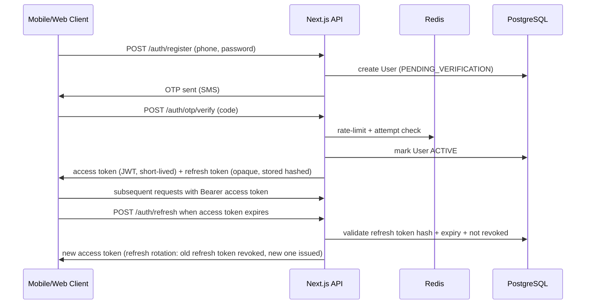

# SAHL — API & Module Structure

Status: Draft v1.0 · Depends on: [02-architecture.md](02-architecture.md), [03-database-schema.md](03-database-schema.md)

## 1. Conventions

- All routes under `apps/backend/src/app/api/v1/**` — version prefix from day one so breaking changes never require a big-bang client migration.
- **Response envelope** (per [00-system-architecture.md](00-system-architecture.md), supersedes the `{data, error, meta}` shape this doc originally drafted before that spec existed — see the note below):
  - Success: `{ success: true, message, data, pagination?, metadata? }`
  - Error: `{ success: false, errorCode, message, details?, traceId, timestamp }`
  - `success` is the discriminator the client branches on, not "is `data` null." `errorCode` is the stable machine-readable value (mobile client branches on it, never on `message` text, so localizing error copy can't break client logic). `traceId` is a per-request correlation ID, logged server-side too, so a support ticket can be tied back to the exact request per the design spec's "every error should provide... support link" rule. Implemented once in `src/presentation/http-response.ts` (`ok()`/`fail()` helpers) rather than assembled inline per route.
- Pagination: cursor-based (`?cursor=&limit=`) on all list endpoints, carried in the `pagination` envelope field — offset pagination degrades badly once provider/request tables are large.
- Every mutating endpoint requires an idempotency key header on financially-relevant actions (payments, payouts, bid acceptance) to make retries safe over unreliable mobile networks.
- Input validation with a schema (Zod) shared from `packages/shared` — the same schema also generates the client-side validation on the Flutter side (via generated Dart) so validation rules are defined once.

## 2. Module → Route Group Map

| Module | Route group | Owns |
|---|---|---|
| Auth | `/api/v1/auth` | register, login, refresh, OTP request/verify, logout |
| Users | `/api/v1/users` | profile CRUD, language/preferences, device token registration |
| Media | `/api/v1/media` | `POST /media/upload` — the one upload endpoint every other module's file fields (chat attachments, provider documents/portfolio, contract/dispute evidence documents) go through; returns a `StorageProvider` URL for the caller to attach to its own entity, rather than each module implementing its own upload handler |
| Companies | `/api/v1/companies` | **Production-ready.** `POST /companies` (create + auto OWNER membership), `GET/PATCH /companies/{id}`, `GET/POST /companies/{id}/members` (list, invite), `PATCH/DELETE /companies/members/{memberId}` (role change, removal — OWNER protected), `POST /companies/invitations/{id}/accept\|cancel`, `GET/POST /companies/{id}/documents`, `POST /companies/{id}/verification/submit`; admin-side `POST /admin/companies/{id}/suspend\|reactivate`, `DELETE /admin/companies/{id}` (soft), `POST /admin/companies/{id}/verification` (review), `PATCH /admin/companies/{id}/documents/{documentId}` (review) — see [ADR-004](02-architecture.md#8-adr-004-businesscompany-accounts-extend-identity-they-dont-fork-it) |
| Providers | `/api/v1/providers` | **Production-ready.** `POST /providers` (profile creation), `GET/PATCH /providers/me`, `POST /providers/me/availability`, `POST /providers/me/verification/submit`, `GET/POST /providers/me/documents`, `GET/POST /providers/me/payout-accounts` + `POST .../{id}/default` + `DELETE .../{id}`, `GET/POST /providers/me/portfolio` + `DELETE .../{id}`; admin-side `POST /admin/providers/{id}/suspend\|reactivate`, `DELETE /admin/providers/{id}` (soft), `POST /admin/providers/{id}/verification` (review), `PATCH /admin/providers/{id}/documents/{documentId}` (review). Service areas/categories/working hours/portfolio-scoring remain schema-only, owned by the upcoming Search/Matching module. |
| Categories | `/api/v1/categories` | taxonomy read (admin-write via `/admin`); `Guest` may read this without authentication |
| Coupons | `/api/v1/coupons` | validate/apply a coupon code at checkout; admin-managed creation via `/admin/coupons` |
| On-Demand | `/api/v1/on-demand` | **Production-ready.** `POST /on-demand` (create + sequential-dispatch to the top `ProviderMatcher` candidate), `GET /on-demand/{id}`, `GET /on-demand/{id}/assignments`, `POST /on-demand/assignments/{assignmentId}/accept\|decline` (decline re-offers to the next candidate), `POST /on-demand/{id}/status` (ASSIGNED→EN_ROUTE→IN_PROGRESS→COMPLETED, accepted-provider-only), `POST /on-demand/{id}/cancel`, `GET/POST /on-demand/{id}/tracking`. `DistanceRatingProviderMatcher` is the v1 rule-based matching implementation (Haversine distance + rating, writing `MatchingScoreLog`) behind the `ProviderMatcher` interface — see [06-smart-matching.md](06-smart-matching.md). |
| Contracts | `/api/v1/contracts` | **Production-ready.** `POST /contracts/projects` (Guest-browsable via `GET .../{id}`), `GET/POST /contracts/projects/{id}/bids`, `POST /contracts/bids/{bidId}/withdraw\|award` (award creates the `Contract` and rejects competing bids), `GET /contracts/{id}`, `GET/POST /contracts/{id}/milestones`, `POST /contracts/milestones/{milestoneId}/status` (party-scoped: provider drives IN_PROGRESS/SUBMITTED, customer drives APPROVED), `POST /contracts/{id}/complete\|cancel`, `GET/POST /contracts/{id}/documents` (versioned). `POST /admin/contracts/milestones/{milestoneId}/mark-paid` is the manual APPROVED→PAID step standing in for a `RELEASE_ESCROW` workflow action (ADR-009) until Payments is built. |
| Remote | `/api/v1/remote` | **Production-ready.** `POST /remote` (direct customer→provider engagement, no bidding step), `GET /remote/{id}`, `POST /remote/{id}/deliver\|complete\|cancel`, `GET/POST /remote/{id}/milestones` + `POST /remote/milestones/{milestoneId}/status` (same party-scoped shape as Contracts), `GET/POST /remote/{id}/revisions` + `POST /remote/revisions/{revisionId}/status` (requesting a revision returns a DELIVERED engagement to ACTIVE), `GET/POST /remote/{id}/meetings`. `POST /admin/remote/milestones/{milestoneId}/mark-paid` mirrors the Contracts admin route. |
| Payments | `/api/v1/payments` | charge initiation, webhook receivers |
| Wallets | `/api/v1/wallets` | `GET /wallets/me` (bucketed `WalletBalance`s), `GET /wallets/me/transactions` (`PaymentTransaction` history) — see [09-financial-core.md](09-financial-core.md) §5 for the full Financial Core contract |
| Withdrawals | `/api/v1/withdrawals` | provider-initiated withdrawal requests/history; staff approval and `Settlement` batching under `/admin/withdrawals` and `/admin/finance/settlements` |
| Subscriptions | `/api/v1/subscriptions` + `/api/v1/subscription-plans` | current subscription, upgrade/downgrade/cancel; plan catalog is `Guest`-accessible |
| Reviews | `/api/v1/reviews` | post-completion review submission/read |
| Favorites | `/api/v1/favorites` | save/unsave a provider, list a customer's favorites |
| Support | `/api/v1/support` | support ticket creation/read for the caller's own tickets; staff-side triage lives under `/admin/support` |
| Disputes | `/api/v1/disputes` | raise a dispute against a completed/paid entity; staff-side resolution lives under `/admin/disputes` |
| Referrals | `/api/v1/referrals` | fetch/generate the caller's own referral code, redeem a code at registration |
| Notifications | `/api/v1/notifications` | list/read notifications (push delivery itself is server-initiated, not client-polled) |
| Config | `/api/v1/config` | `GET /config` — the client-facing read side of [ADR-007](02-architecture.md#11-adr-007-admin-panel-as-platform-control-center): resolved `RemoteConfigEntry` values, the published `HomeLayoutBlock` layout, and active `PopupCampaign`s for the caller's region/targeting context, in one call the app makes on cold start. `Guest`-accessible — config must be fetchable before login. |
| CMS | `/api/v1/pages` | `GET /pages/{slug}` — published `CmsPage` content by slug, locale-resolved; `Guest`-accessible |
| Admin | `/api/v1/admin/**` | moderation (incl. `Report` triage), verification queue, support/dispute resolution, RBAC management, audit log read, **plus every ADR-007 module**: `/admin/config` (RemoteConfigEntry CRUD), `/admin/cms` (CmsPage CRUD/publish), `/admin/home-builder` (HomeLayoutBlock CRUD/reorder/publish), `/admin/ads` (Advertisement + analytics), `/admin/notifications` (NotificationBroadcast send/schedule), `/admin/popups` (PopupCampaign CRUD), `/admin/templates` (MessageTemplate CRUD), `/admin/ai` (AiFeatureToggle + AiProviderConfig + AiUsageLog read), `/admin/dashboard` (AdminDashboardWidgetPreference + widget data), **plus every ADR-008 Financial Core module**: `/admin/finance/commission-rules`, `/admin/finance/tax-rules`, `/admin/finance/refund-policies`, `/admin/finance/settlements`, `/admin/finance/withdrawals` (approval workflow), `/admin/finance/ledger` (chart of accounts + trial balance read), `/admin/finance/reports` (export), **plus every ADR-009 Workflow Engine module**: `/admin/workflows` (WorkflowDefinition/WorkflowStep CRUD, version/clone/publish, dry-run test), `/admin/automation-rules` (AutomationRule CRUD), `/admin/workflow-instances` (read-only instance/execution history for ops visibility) — every route requires a `StaffRole` permission check |

Chat and live tracking are **not** REST endpoints in steady state — they're Socket.IO events against the decoupled realtime service (ADR-002); REST is only used to fetch conversation history on cold start. Voice/image/file messages ride the same `Message` events with `type` set accordingly — not a separate upload endpoint per media type — attachments are uploaded to Cloudinary first and the resulting URL is what's sent over the socket.

Analytics (§ Success Metrics in [01-product-overview.md](01-product-overview.md) §9) is **not** a domain module of its own — it's read-only reporting over existing tables (`/admin/analytics`), computed from data every other module already writes (orders, ratings, disputes, transactions), not a new write path.

Promotions and advertising (`PromotionalCampaign`, `Advertisement`) are admin-managed only in v1 (`/admin/promotions`, `/admin/ads`) — no self-serve provider-facing endpoint yet, consistent with these being off-by-default growth-phase levers (see [03-database-schema.md](03-database-schema.md) §3).

Per ADR-007, `/admin/config`, `/admin/cms`, `/admin/home-builder`, `/admin/popups`, and `/admin/notifications` are all thin CRUD + publish-lifecycle wrappers around their respective tables — there's no bespoke business logic per module beyond validating `targetingRules` against the shared schema (`packages/shared/schemas/targeting.schema.ts`) and enforcing the `PublishStatus` transitions (`DRAFT → SCHEDULED → PUBLISHED → ARCHIVED`). This is intentional: the modules are deliberately similar because they share the same two underlying primitives (§1 conventions apply identically to all of them), not five independently-designed subsystems.

**Guest access**: `Guest` (docs/01-product-overview.md §5) is not a role check anywhere in the API — it's simply the set of `GET` routes that don't require a `Bearer` token: category browsing, provider search/profile-view, public review reads, `GET /config`, and `GET /pages/{slug}`. Every mutating route and every route returning personal data (profile, wallet, orders, chat) requires authentication; there is no separate "guest permission" to maintain, just an explicit allow-list of unauthenticated `GET`s enforced at the presentation-layer middleware.

## 3. RBAC Model

Three independent axes, deliberately not merged into one `role` enum (see [03-database-schema.md](03-database-schema.md) §1):

1. **Customer/Provider duality** — every authenticated `User` may act as customer always, and as provider once `ProviderProfile` exists and is not suspended. Authorization checks "does this user own this provider profile / is this the request's customer", not a static role.
2. **Staff RBAC** — `StaffRole` → `Permission` (many-to-many), `User` → `StaffRole` (many-to-many, a user can hold multiple staff roles). All `/admin/**` routes declare a required `Permission` key; middleware resolves the caller's permissions once per request (cached in Redis per session) and rejects with `403 FORBIDDEN` otherwise.
3. **Company membership** — `CompanyMember.role` (`OWNER | MANAGER | STAFF`), scoped to one `Company`. Routes under `/companies/{id}/**` and company-attributed actions on `/providers`, `/on-demand`, `/contracts`, `/remote` resolve the caller's membership row for that specific `companyId` — a `STAFF` member of Company A has no standing on Company B, and this check is independent of whatever `StaffRole`/platform-admin permissions the same person might separately hold.

### Permission matrix (illustrative — full list lives in seed data, not hardcoded here)

| Permission key | Super Admin | Admin | Support | Moderator | Verification Officer | Finance Officer |
|---|:---:|:---:|:---:|:---:|:---:|:---:|
| `provider.verify` | ✓ | ✓ | | | ✓ | |
| `listing.moderate` | ✓ | ✓ | | ✓ | | |
| `report.moderate` | ✓ | ✓ | | ✓ | | |
| `ticket.manage` | ✓ | ✓ | ✓ | | | |
| `dispute.resolve` | ✓ | ✓ | | | | ✓ |
| `withdrawal.approve` | ✓ | | | | | ✓ |
| `commission.configure` | ✓ | | | | | ✓ |
| `promotion.manage` | ✓ | ✓ | | | | |
| `staffrole.manage` | ✓ | | | | | |
| `audit.read` | ✓ | ✓ | | | | ✓ |
| `remote_config.configure` | ✓ | | | | | |
| `cms.publish` | ✓ | ✓ | | | | |
| `home_builder.publish` | ✓ | ✓ | | | | |
| `ai.configure` | ✓ | | | | | |
| `ledger.view` | ✓ | | | | | ✓ |
| `settlement.configure` | ✓ | | | | | ✓ |
| `tax_rule.configure` | ✓ | | | | | ✓ |
| `workflow.configure` | ✓ | | | | | |
| `workflow.publish` | ✓ | | | | | |
| `automation_rule.configure` | ✓ | | | | | |

`Super Admin` is not "all permissions hardcoded" — it's seeded with every permission explicitly, so the audit log shows a real grant, not an implicit bypass. `withdrawal.approve` was `payout.approve` before the [ADR-008](02-architecture.md#12-adr-008-financial-core-double-entry-ledger-architecture) rename. `workflow.configure`/`workflow.publish` are `Super Admin`-only, same reasoning as `remote_config.configure`/`ai.configure` — a misconfigured published workflow can trigger real money movements (`RELEASE_ESCROW`) or mass notifications automatically, so this is not a role to delegate broadly at launch.

The bottom four rows follow [ADR-007](02-architecture.md#11-adr-007-admin-panel-as-platform-control-center)'s `<module>.<action>` convention (`action ∈ {view, create, edit, delete, export, approve, reject, configure, publish}`) — a naming rule, not new schema, since `Permission.key` was already a free string. `remote_config.configure` and `ai.configure` are deliberately `Super Admin`-only in this illustrative seed: both control platform-wide behavior (fees, rate limits, which AI vendor is live) where a mis-click has outsized blast radius, unlike `cms.publish`/`home_builder.publish` which `Admin` can also hold.

## 4. Auth Flow

Sensitive actions (payout request, changing linked bank/payment details, staff role changes) require a fresh OTP step-up (`purpose: SENSITIVE_ACTION`), not just a valid access token — protects against a stolen short-lived token being used for high-impact actions.

## 5. Rate Limiting

Redis-backed sliding window per (userId or IP) × endpoint-class:

- Auth endpoints: aggressive limits (brute-force/OTP-spam protection).
- Write endpoints: moderate limits.
- Read endpoints: generous limits, primarily abuse/scraping protection.

Limits are configuration, not hardcoded per-route constants, so they can be tuned without a deploy once real traffic patterns are known.
