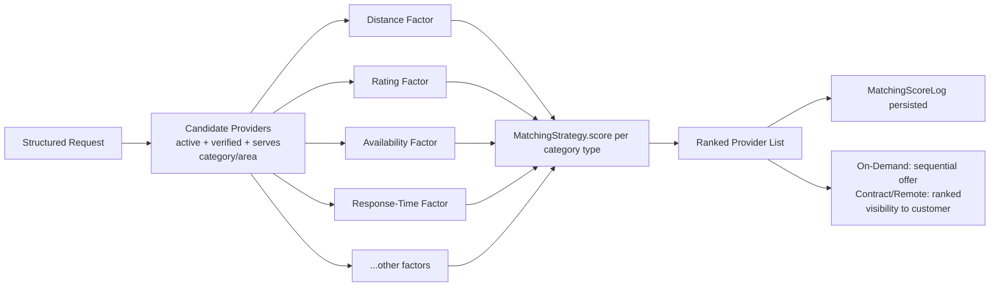

# SAHL — Smart Matching Engine

Status: Draft v1.0 · Domain module: `domain/matching` (see [02-architecture.md](02-architecture.md) §3)

## 1. Two Distinct Problems

The brief's "understand intent, don't behave like a directory" principle splits into two separable subsystems that must not be conflated:

1. **Intent classification** — free text ("My car stopped") → structured `ServiceCategory` (+ urgency). This is an NLP/classification concern, sits in front of matching, and is the first of the "Future AI Features" (natural language search, automatic category detection). Formalized as `domain/ai/intent-classifier.ts`'s `IntentClassifier` interface per [ADR-005](02-architecture.md#9-adr-005-ai-integration-layer) — MVP ships with `KeywordIntentClassifier` (the rule-based default) and swaps in a model-backed implementation later purely via `infrastructure/ai/registry.ts`, without changing anything downstream, because both produce the same output contract: a `categoryId` + confidence + urgency.
2. **Provider ranking** — given a structured request (category + location/budget/etc.), rank candidate providers. This is the "Smart Matching Engine" proper, described below.

Keeping these separate means improving the NLP classifier is a self-contained change; it never touches ranking logic, and vice versa.

## 2. Ranking Factors

From [00-master-prompt.md](00-master-prompt.md): distance, availability, price, rating, response time, completed jobs, experience, verification status, cancellation rate, customer preferences.

[00-functional-requirements.md](00-functional-requirements.md) adds two more:

- **Current Workload** — not a stored column; computed at match time from the candidate's count of active (`ASSIGNED`/`EN_ROUTE`/`IN_PROGRESS`) `OnDemandAssignment`/`Contract`/`RemoteEngagement` rows. A provider buried in active jobs should rank lower even if otherwise well-matched — this is deliberately *not* denormalized onto `ProviderProfile` (unlike `completedJobsCount`, which is a durable historical count) because it changes on every assignment/completion and a cached counter would drift without an event-sourcing mechanism this MVP doesn't have.
- **Emergency Status** — `OnDemandRequest.isEmergency` (see [03-database-schema.md](03-database-schema.md)) both filters candidates (only providers with `emergencyAvailable = true` are eligible when set) and re-weights the strategy: distance and response-time factors dominate for emergency requests, price/rating matter comparatively less — a different `MatchingStrategy` weight profile for the same `ServiceType`, not a new code path.

## 3. Design: Weighted Scoring, Not a Black Box

`domain/matching` defines:

```
interface ScoringFactor {
  key: string
  compute(candidate: ProviderCandidate, context: MatchingContext): number // normalized 0..1
}

interface MatchingStrategy {
  categoryType: ServiceType // ON_DEMAND | CONTRACT | REMOTE
  factors: { factor: ScoringFactor; weight: number }[]
  score(candidate, context): number // weighted sum, or a pluggable aggregator
}
```

Each factor (distance, rating, response time, etc.) is an independent, unit-testable module. A `MatchingStrategy` composes factors with weights **per service type** — distance matters heavily for On-Demand towing, not at all for Remote programming work; price flexibility matters more for Contract bidding than same-day plumbing. This is why matching is modular per the brief's "algorithm must be modular and improve over time" requirement: weights are configuration (seed data / admin-editable table), factor implementations are code, and neither requires touching the other to tune the system.



## 4. Candidate Pre-filtering (before scoring, not part of the weighted score)

Hard filters, applied before any scoring runs — these are eligibility gates, not factors to be weighted, because a provider outside them should never appear regardless of how well they'd otherwise score:

- Provider is `isAvailable` (On-Demand) or accepting new work.
- Provider's `ProviderServiceArea` covers the request location (On-Demand) — geo lookup via PostGIS/Redis geo index for latency.
- Provider is associated with the request's `ServiceCategory` via `ProviderCategory`.
- Provider is not suspended/banned.

Unverified providers are not hard-filtered out (would hurt marketplace liquidity at launch) but verification status is itself a scoring factor — see §2 — so verified providers naturally rank higher.

## 5. Latency Path (On-Demand specifically)

On-Demand matching must be near-real-time. Candidate pre-filtering and hot factors (current location, availability) are served from Redis (geo index + availability flags kept in sync from Postgres via the application layer on every relevant state change), not queried fresh from Postgres per request — this is the concrete reason Redis is in the stack beyond simple caching.

Contract and Remote matching are not latency-sensitive in the same way (bidding/browsing, not instant dispatch) and can score directly against Postgres.

## 6. Auditability & Future AI

Every computed ranking writes a `MatchingScoreLog` row with the full factor breakdown (see [03-database-schema.md](03-database-schema.md) §3). This exists so that:

- Disputes ("why wasn't I offered this job") are answerable.
- The weighted-scoring MVP has a labeled dataset to eventually train a learned ranking model against — satisfying "the algorithm must... improve over time" without committing to ML before there's data to justify it.

**"Intelligent provider matching" and "dynamic ranking" (both named in [00-system-architecture.md](00-system-architecture.md)) plug in here** via `domain/ai/ranking-adjuster.ts`'s `RankingAdjuster` — it receives the `MatchingStrategy`'s base ranking and returns adjusted scores, never a replacement ranking that skips the hard eligibility pre-filters in §4. Same ADR-005 registry/toggle mechanism as intent classification: disabled by default, degrades to "no adjustment" (the base weighted score stands unchanged), never a hard dependency.

## 7. Explicitly Deferred

- Customer preference learning (implicit signal from past bookings) — needs usage data that doesn't exist pre-launch. Slots into `RecommendationProvider` (`domain/ai/recommendation-provider.ts`) once there's data to train on.
- Fraud-detection and demand-forecasting factors — listed as Future AI Features in the brief, not MVP scope. Interfaces already exist (`FraudSignalProvider`, `DemandForecastProvider`) per [ADR-005](02-architecture.md#9-adr-005-ai-integration-layer); no implementation yet.
