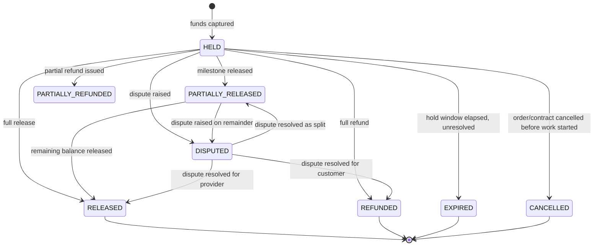
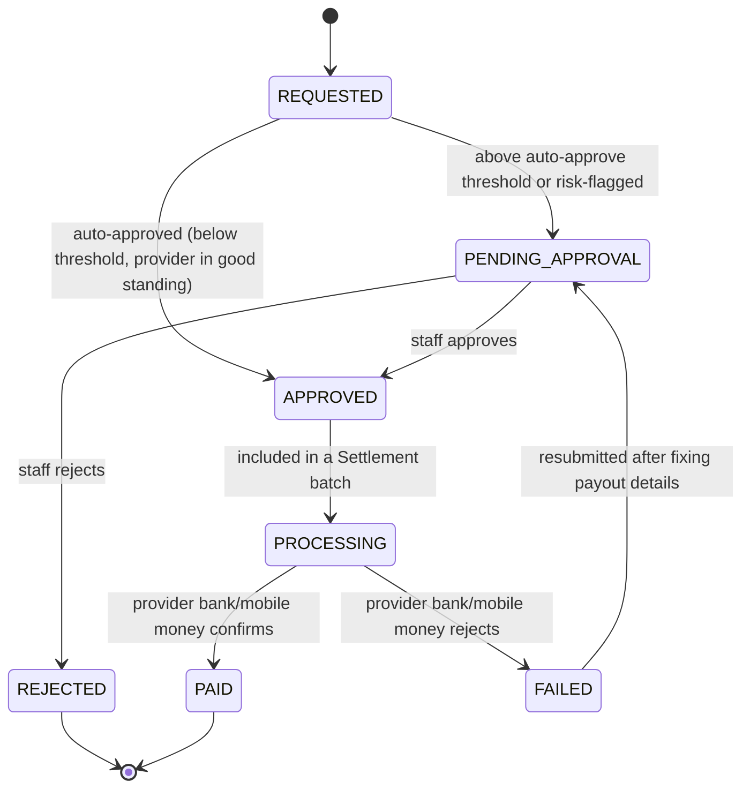
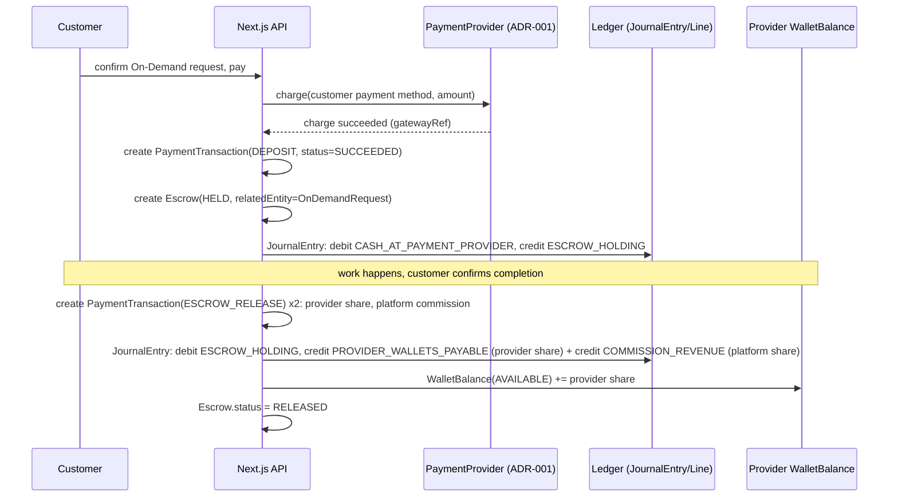

# SAHL — Financial Core (Engineering Reference)

Status: Draft v1.0 · Source: [00-financial-core-spec.md](00-financial-core-spec.md) · Architecture decision: [ADR-008](02-architecture.md#12-adr-008-financial-core-double-entry-ledger-architecture)

This doc is the engineering bridge from the Phase 8 spec to the schema in [`apps/backend/prisma/schema.prisma`](../apps/backend/prisma/schema.prisma) — module map, state machines, one sequence diagram, API contract sketch, and what's explicitly deferred. Read ADR-008 first; this doc assumes its ledger/wallet-bucket/escrow decisions as given.

## 1. Module → Table Map

| Spec module | Tables | Notes |
|---|---|---|
| Customer Wallet, Provider Wallet | `Wallet`, `WalletBalance` | One model for both — `WalletBucket` values differ by convention per owner, not by schema (ADR-008) |
| Escrow Engine | `Escrow` | One row per holding — per-milestone via the polymorphic reference, not per-contract |
| Transaction Engine | `PaymentTransaction`, `JournalEntry`, `JournalLine` | Customer/provider-facing record + its balanced accounting entry |
| Commission Engine | `CommissionRule` | Extended with `providerId`/`subscriptionPlanId` scope, `minFeeMinorUnits`/`maxFeeMinorUnits` |
| Settlement Engine | `Settlement` | Batches `Withdrawal` rows; schedule is `SettlementSchedule` |
| Withdrawal Engine | `Withdrawal` (renamed from `Payout`) | Approval workflow fields, `method`, `feeMinorUnits` |
| Refund Engine | `PaymentTransaction` (`type: REFUND`), `RefundPolicy` | No separate "partial refund" type — see ADR-008 |
| Promotions Engine | `Coupon`, `CouponRedemption`, `PromotionalCampaign`, `ReferralCode`/`ReferralRedemption` | Already built in earlier rounds — this phase didn't need to touch it |
| Subscription Engine | `SubscriptionPlan`, `Subscription` | Plan = admin-configured product; Subscription = one customer/company's enrollment |
| Accounting Engine | `LedgerAccount`, `JournalEntry`, `JournalLine` | The general ledger itself |
| Payment Provider Layer | `PaymentGatewayConfig` + `domain/payments/payment-provider.ts` (interface only, per ADR-001) | Not re-designed this phase — ADR-001 already specified this correctly |
| Currency Engine | `ExchangeRate` | Rate captured per-transaction, never recomputed retroactively |
| Tax Engine | `TaxRule` | Region + category scoped |
| Financial Reports | *(no new tables)* | Reporting over existing tables, same conclusion as Analytics in [04-api-modules.md](04-api-modules.md) |
| Admin Platform | *(ADR-007's existing mechanism)* | Commission/withdrawal/escrow/tax/subscription config is either its own relationally-shaped table (above) or a `RemoteConfigEntry` scalar — no new admin architecture needed |

## 2. Escrow State Machine

Each transition that moves money (`HELD → PARTIALLY_RELEASED`, `→ RELEASED`, `→ REFUNDED`, etc.) writes an `ESCROW_RELEASE` or `REFUND` `PaymentTransaction` (each with its own balanced `JournalEntry`) referencing this `Escrow` via `relatedEntityType: ESCROW`. The `Escrow.status` column is a cache of "what's the aggregate outcome so far," not the movement history itself — that lives in the transactions.

## 3. Withdrawal State Machine

The auto-approve threshold, daily/monthly withdrawal limits, and per-method fees are `RemoteConfigEntry` values (ADR-007) — evaluated by the application layer against the requesting provider's rolling withdrawal history (a query over `Withdrawal`/`PaymentTransaction`, not a separate counter table).

## 4. Sequence: On-Demand Payment Flow (Charge → Escrow → Release → Commission Split)

Tax (if `TaxRule` applies) is a third `JournalLine` (credit `TAX_PAYABLE`) within the same release `JournalEntry`, and a `PROCESSING_FEE` transaction if the gateway charges its own fee — the release event can produce several `PaymentTransaction` rows, each independently meaningful to the party who sees it, all tied to journal entries that individually balance.

## 5. API Contract Sketch

Extends [04-api-modules.md](04-api-modules.md) §2:

| Route group | Owns |
|---|---|
| `/api/v1/wallets` | `GET /wallets/me` (bucketed balances), `GET /wallets/me/transactions` (paginated `PaymentTransaction` history) |
| `/api/v1/withdrawals` | provider-initiated withdrawal requests, withdrawal history; staff approval under `/admin/withdrawals` |
| `/api/v1/subscriptions` | current subscription, upgrade/downgrade/cancel; plan catalog is public (`GET /subscription-plans`, `Guest`-accessible) |
| `/admin/finance/**` | `/admin/finance/commission-rules`, `/admin/finance/tax-rules`, `/admin/finance/refund-policies`, `/admin/finance/settlements`, `/admin/finance/ledger` (chart of accounts + trial balance read), `/admin/finance/reports` (CSV/Excel/PDF export) |

Escrow has no direct customer/provider-facing route — it's driven by the On-Demand/Contract/Remote request lifecycle endpoints already documented; `GET /requests/{id}` includes escrow status as part of the request's detail response, not a separate escrow endpoint.

## 6. Security

Per [05-security.md](05-security.md), with financial-specific additions:

- **Immutability** (ADR-008) is itself a security control — an attacker or bug that could edit historical `PaymentTransaction`/`JournalLine` rows could hide fraud; the only way to correct a mistake is a new offsetting `ADJUSTMENT`, which is itself audit-logged.
- **Maker-checker for manual adjustments**: an `ADJUSTMENT` or `PENALTY` transaction requires `reason` (enforced at the application layer) and is written to `AuditLog` with the acting staff member — the existing audit convention, applied specifically to money movements that don't originate from an automated flow.
- Idempotency keys (already required on financially-relevant mutating endpoints per [04-api-modules.md](04-api-modules.md) §1) apply to every route in this doc's §5 table without exception.
- `AiFeatureToggle.capability = FRAUD_DETECTION` (ADR-005) is the seam for the spec's "Fraud Detection Hooks" — `FraudSignalProvider.evaluate()` is called before a `Withdrawal` moves from `REQUESTED`/`PENDING_APPROVAL` to `APPROVED`, and before a large `DEPOSIT`/`REFUND`; today that's the rule-based heuristics in [05-security.md](05-security.md) §6, swappable for a real model later without touching the withdrawal/refund call sites.

## 7. Testing Strategy

Consistent with the existing review checklist ([07-roadmap.md](07-roadmap.md) §5, "Testable"): the ledger-balancing invariant (`sum(debits) == sum(credits)` per `JournalEntry`) is domain-layer logic with no database dependency, so it's covered by unit tests that construct `JournalLine` sets and assert the invariant — no live Postgres required. State-machine transitions (Escrow, Withdrawal) are tested the same way: given a current status and an event, assert the allowed next-status set, independent of persistence. Integration tests (real Postgres, real transaction) are reserved for the handful of places atomicity actually matters — e.g. "does creating a `PaymentTransaction` + its `JournalEntry` + updating `WalletBalance` happen in one DB transaction or not at all."

## 8. Migration Strategy

No live database exists yet on this project (Node.js isn't installed on the scaffold machine — see [07-roadmap.md](07-roadmap.md) open items), so this schema round — including the `Payout` → `Withdrawal` rename and the removal of `Wallet.balance` — required no data migration, only a schema rewrite. Once a real database exists, standard Prisma migration tooling (`prisma migrate dev`/`deploy`) applies; the one financial-specific rule going forward is that a migration touching `PaymentTransaction`, `JournalEntry`, or `JournalLine` must never rewrite historical rows — only add columns/tables, per the immutability rule in ADR-008.

## 9. Future Expansion Strategy

Multi-country/multi-currency is already load-bearing, not bolted on: `LedgerAccount`, `Wallet`, `PaymentTransaction`, `ExchangeRate`, and `TaxRule` are all currency- and (where relevant) region-scoped from this schema round, the same way `Region` was designed to be additive in [ADR-001](02-architecture.md#adr-001-locale--payment-abstraction). Adding a second country's tax rules, commission structure, or currency is new rows in `TaxRule`/`CommissionRule`/`ExchangeRate`, not a schema change. A new payment gateway, per ADR-001, is a new `infrastructure/payments/<gateway>/` adapter plus a `PaymentGatewayConfig` row.

## 10. Explicitly Deferred

- **Real payment gateway adapter** — `domain/payments/payment-provider.ts` and a concrete implementation aren't built in this round; ADR-001 already specified the interface shape, and building the adapter without a selected gateway (still an open item in [07-roadmap.md](07-roadmap.md)) would be guessing at a wire protocol.
- **Report rendering (CSV/Excel/PDF export)** — a presentation-layer concern over data that already exists in the tables above; not built until there's a real environment to generate and verify a file against (Node isn't installed on this machine).
- **A `LedgerAccount` per-user or event-sourced wallet read-model** — only justified if `WalletBalance` read performance is a measured problem (ADR-008's revisit trigger), not built speculatively.
- **International Withdrawal providers beyond bank transfer/wallet transfer/mobile money** — `WithdrawalMethod` is an enum today (not a free string) because the source spec names exactly these three for now; if "Future International Providers" becomes concrete enough to need its own method-specific fields, revisit whether it should become a `provider`-style free string resolved through a registry (matching `PaymentProvider`/`AIProvider`) instead.
