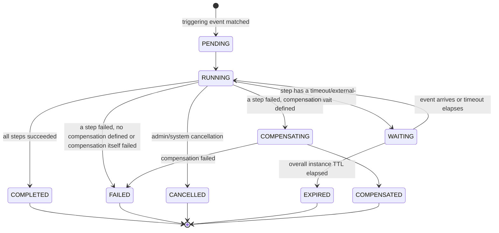
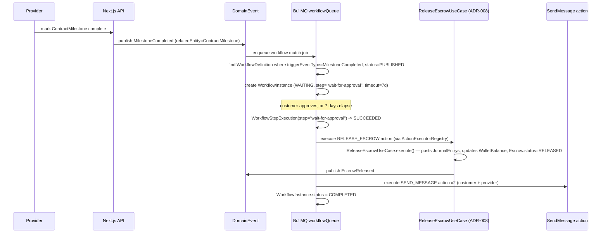

# SAHL — Workflow Engine (Engineering Reference)

Status: Draft v1.0 · Source: [00-workflow-engine-spec.md](00-workflow-engine-spec.md) · Architecture decision: [ADR-009](02-architecture.md#13-adr-009-workflow-engine-as-a-cross-entity-orchestration-layer)

Read ADR-009 first: the Workflow Engine orchestrates *between* entities via events; it does not replace any entity's own status enum.

## 1. The 23 Required "Workflow Types" — What Already Exists vs. What's New

| Spec item | Already exists (entity state machine) | New (`WorkflowDefinition`) |
|---|---|---|
| User Registration | `UserStatus`, `OtpCode` flow | — |
| Identity Verification (KYC) | `ProviderProfile.verificationStatus`, `ProviderDocument.status` | Orchestration: document upload → AI review → human review → activate (spans 3 entities + AI + notification) |
| Provider Onboarding | `ProviderProfile` fields | Same orchestration as KYC, extended with welcome sequence |
| Company Registration | `Company`/`CompanyMember` | — |
| Service Publishing / Approval | `ServiceCategory.isActive`, `ProviderCategory` | Optional moderation-approval process if/when publishing needs review, not required for launch |
| Booking (On-Demand) | `OnDemandStatus`, `OnDemandAssignment` | Assignment offer → timeout → next candidate (already the matching engine's job, [06-smart-matching.md](06-smart-matching.md) — the Workflow Engine doesn't re-decide ranking) |
| Short-Term Jobs | `OnDemandStatus` | — |
| Long-Term Contracts | `ContractProjectStatus`, `ContractStatus` | Bid deadline expiry, award notification |
| Remote Services | `RemoteEngagementStatus` | — |
| Milestone Projects | `MilestoneStatus` (Contract + Remote) | **Milestone completion**: approve-or-7-day-timeout → `RELEASE_ESCROW` → notify both parties — the worked reference example, §3 below |
| Escrow Lifecycle | `EscrowStatus` (ADR-008) | Expiry handling, dispute-triggered pause |
| Wallet Operations | `WalletBalance`, `JournalEntry` (ADR-008) | — |
| Withdrawals | `WithdrawalStatus` (ADR-008) | Approval-chain orchestration once approval rules get complex enough to need more than a single threshold check |
| Refunds | `TransactionType.REFUND`, `RefundPolicy` (ADR-008) | Approval workflow for refunds outside policy window |
| Disputes | `DisputeStatus` | **Escalation**: unresolved 14 days → `ESCALATE_CASE` — an `AutomationRule`, §5 |
| Ratings | `Review` | — |
| Reports | `Report`, `ReportStatus` | — |
| AI Review | *(none — new concept)* | A workflow step of type `AI_EVALUATION`, calling `domain/ai/` via `AiRegistry` (ADR-005) |
| Admin Approval | `StaffRole`/`Permission` (who can approve) | `CREATE_ADMIN_TASK` action + approval-chain steps |
| Subscription Lifecycle | `SubscriptionStatus` (ADR-008) | Trial-ending reminder, renewal, grace-period expiry — event/schedule-driven notifications |
| Promotions | `PromotionalCampaign`/`Coupon` | `PromotionActivated` event triggers notification broadcast |
| Notifications | `Notification`, `NotificationBroadcast` (ADR-007) | The Workflow Engine is a *producer* of notifications via `SEND_MESSAGE`, not a new notification system |
| Maintenance Jobs | `RemoteConfigEntry` (`maintenance_mode`, ADR-007) | Scheduled maintenance-window announcement via `AutomationRule` |

Reading down this table: most rows are already solved. The genuinely new work is the handful of cross-entity sequences in the right column — that's what `WorkflowDefinition`/`AutomationRule` are for, not a rebuild of the left column.

## 2. WorkflowInstance State Diagram

Each `RUNNING`/`WAITING` transition writes a `WorkflowStepExecution` row (immutable, one per attempt) — the audit trail this ADR requires.

## 3. Sequence: Milestone Completion → Escrow Release (Worked Reference)

This is the concrete slice built this round: `ReleaseEscrowUseCase` now publishes `EscrowReleased` (a small, additive change), `ActionExecutorRegistry` resolves `RELEASE_ESCROW`/`SEND_MESSAGE` to real executors, and `ReleaseEscrowActionExecutor` calls the *existing* Financial Core use case rather than reimplementing it. The "wait for approval or 7-day timeout" step, the event-to-workflow matching job, and the `WorkflowInstance` bookkeeping around it are schema-complete but not code-complete this round — see §7.

## 4. Admin Workflow Builder Design

Reuses [ADR-007](02-architecture.md#11-adr-007-admin-panel-as-platform-control-center)'s established pattern — this is not new admin architecture:

- **Create/Modify/Clone/Version**: standard CRUD on `WorkflowDefinition`/`WorkflowStep`, with `key`+`version` uniqueness meaning "clone" is "create a new version row with the same `key`."
- **Enable/Disable/Publish**: `PublishStatus` transitions, same as `CmsPage`/`HomeLayoutBlock` — `PUBLISHED` definitions are eligible to match incoming events; `DRAFT`/`ARCHIVED` are not.
- **Test**: a "dry run" mode — construct a `WorkflowInstance` against a real or synthetic triggering entity without actually invoking side-effecting `WorkflowActionExecutor`s (each executor's `execute()` can be called in a `dryRun` context that validates config shape and returns a simulated result — a small addition to the executor interface when the Test feature is actually built, not designed further here).
- **Approval chains, timeouts, retry counts, escalation policies**: all `WorkflowStep`/`AutomationRule` fields (`timeoutSeconds`, `maxRetries`, `conditionExpression`) — admin-editable data, no code change to add or adjust one.

## 5. Automation Rule Examples (from the spec)

| Rule | `triggerEventType` / `scheduleCron` | `conditionExpression` (illustrative) | `actionType` |
|---|---|---|---|
| Provider inactive 90 days → suspend | `scheduleCron: "0 3 * * *"` (daily scan) | `{ all: [{ field: "daysSinceLastActivity", operator: "gte", value: 90 }] }` | admin action to suspend (`ESCALATE_CASE` or a dedicated suspend action added when this rule is actually built) |
| Withdrawal > limit → require approval | `triggerEventType: "WithdrawalRequested"` | `{ all: [{ field: "amount", operator: "gt", value: 500000 }] }` | `CREATE_ADMIN_TASK` |
| Dispute unresolved 14 days → escalate | `scheduleCron: "0 * * * *"` (hourly scan) | `{ all: [{ field: "status", operator: "eq", value: "OPEN" }, { field: "daysOpen", operator: "gte", value: 14 }] }` | `ESCALATE_CASE` |
| Milestone overdue → notify both | `scheduleCron: "0 6 * * *"` (daily scan) | `{ all: [{ field: "status", operator: "eq", value: "IN_PROGRESS" }, { field: "daysPastDue", operator: "gt", value: 0 }] }` | `SEND_MESSAGE` |

Schedule-triggered rules need a per-rule "candidate scan" (which table to query, e.g. `ProviderProfile` for the inactivity rule) — this is per-rule application logic, not a generic interpreter, and is built as each rule becomes concrete (§7).

## 6. API Contracts

Extends [04-api-modules.md](04-api-modules.md) §2:

| Route group | Owns |
|---|---|
| `/admin/workflows` | `WorkflowDefinition`/`WorkflowStep` CRUD, version/clone/publish, dry-run test |
| `/admin/automation-rules` | `AutomationRule` CRUD |
| `/admin/workflow-instances` | read-only: list/filter running and historical `WorkflowInstance`s + their `WorkflowStepExecution` history, for ops visibility and debugging — no direct mutation beyond `CANCELLED` |

No customer/provider-facing routes — the Workflow Engine is purely a backend orchestration layer; its effects are visible through the entities/notifications it touches, not through a dedicated API surface.

## 7. Explicitly Deferred

- **The `conditionExpression` evaluator** — the code that walks a `{ all: [...] }`/`{ any: [...] }` JSON blob and checks it against an entity's fields. Schema exists (`Json` column, documented informal shape); the evaluator is scoped when the first real `AutomationRule` needs it, not built speculatively against a guessed rule shape now — same restraint applied to `targetingRules`' evaluator in ADR-007.
- **Per-rule scheduled-scan jobs** — "find all providers inactive 90 days" is a specific query per automation rule; a generic "scan every entity against every condition" engine would be far more complex than the handful of concrete rules the spec actually names. Built per rule as each is implemented.
- **11 of 14 `WorkflowActionType` executors** — only `RELEASE_ESCROW` and `SEND_MESSAGE` are wired this round (§3). `CREATE_ESCROW`, `CREATE_WALLET_TRANSACTION`, `GENERATE_CONTRACT`, `ASSIGN_PROVIDER`, `AI_EVALUATION`, `FRAUD_CHECK`, `CREATE_AUDIT_LOG`, `SCHEDULE_JOB`, `CALL_EXTERNAL_API`, `CREATE_ADMIN_TASK`, `ESCALATE_CASE`, `GENERATE_REPORT` all follow the identical `WorkflowActionExecutor` shape in `infrastructure/workflow/executors/` — added as each is actually invoked by a real workflow, per `ActionExecutorRegistry`'s existing `default: throw` fallback (fails loud, not silently, if an unwired action type is referenced).
- **`GENERATE_INVOICE`** specifically stays unimplemented pending the `Invoice` entity decision already deferred in [03-database-schema.md](03-database-schema.md) §4 (ADR-008) — the action type exists in the enum so a workflow *can* reference it, but its executor is a stub until that entity exists.
- **AI workflow-optimization capabilities** (delay prediction, risk prediction, failure detection, automation suggestions) — no new `domain/ai/` interface added; `WorkflowInstance`/`WorkflowStepExecution` (timestamped, outcome-labeled) are the structured data a future capability would consume, per ADR-009.
- **The event-to-workflow matching job itself** (the BullMQ worker that reads a new `DomainEvent`, finds matching `PUBLISHED` `WorkflowDefinition`s and active `AutomationRule`s, and creates `WorkflowInstance`s) — `infrastructure/jobs/queue.ts` gains a `workflowQueue` per ADR-009, but the worker function is not implemented in this schema-and-pattern round.

## 8. Security

No new security model — [05-security.md](05-security.md) applies directly: `/admin/workflows` and `/admin/automation-rules` require `StaffRole` permissions (`workflow.configure`, `automation_rule.configure`, following the established `<module>.<action>` convention from ADR-007); every `WorkflowStepExecution` is an immutable audit record (same posture as `PaymentTransaction`/`JournalLine`, ADR-008); a `WorkflowActionExecutor` that calls a financial or fraud-sensitive use case inherits that use case's own security checks (e.g. `ReleaseEscrowActionExecutor` gets no special privilege — it hits the same `ReleaseEscrowUseCase` a human-triggered API route would).

## 9. Testing Strategy

Consistent with the existing review checklist ([07-roadmap.md](07-roadmap.md) §5): `WorkflowActionExecutor` implementations are unit-testable in isolation (given a context, assert the result) without a live database, the same way `AIProvider` adapters are. The `conditionExpression` evaluator (once built, §7) is pure domain logic — given a rule blob and an entity snapshot, assert true/false — no framework dependency. Integration tests are reserved for the event-matching job and multi-step instance execution, where ordering and persistence actually matter.

## 10. Future Expansion Strategy

Multi-country/multi-currency needs nothing new here — a `WorkflowDefinition` can already be `Region`-scoped via its `conditionExpression` (e.g. gate a step on the triggering entity's region) without a schema change, the same targeting-by-data-not-by-code posture as everywhere else in this codebase. New action types are additive `WorkflowActionType` enum values + a new executor class registered in `ActionExecutorRegistry` — the same additive shape every registry in this codebase already supports (`PaymentProvider`, `AIProvider`, and now workflow actions).
